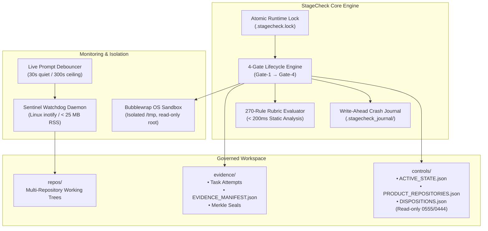
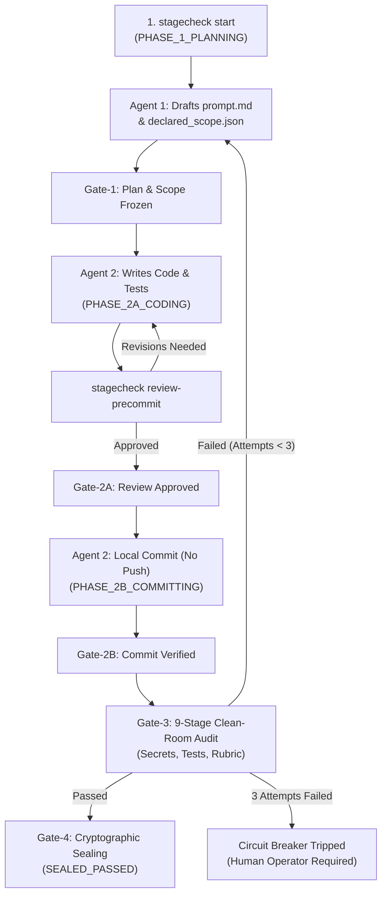
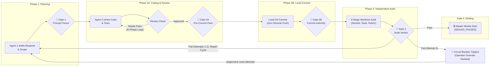
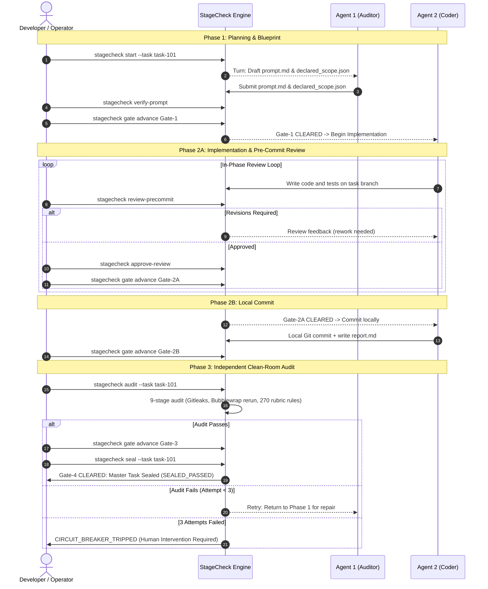

# 🛡️ StageCheck

**Deterministic AI Software Delivery Governance & Multi-Agent Verification (`v2.0.0`)**

---

## 📌 What is StageCheck?

**StageCheck** is a lightweight, fail-closed governance tool designed for autonomous AI coding agents (such as Claude Code, Codex, or Gemini Etc...). 

When AI agents work on software codebases, they risk modifying unauthorized files, skipping tests, leaking credentials, or running infinite token-burning repair loops. StageCheck acts as an automated, impartial supervisor: it confines agents to a declared project scope, enforces quality gates between planning and delivery, scans for secrets, runs tests in an isolated sandbox, and cryptographically seals verified work.

---

## 🎯 What is the Use of StageCheck?

* **Scope Containment:** Prevents AI agents from touching files outside their declared blueprint.
* **Separation of Duties (Dual-Agent):** Ensures **Agent 1 (Auditor)** defines the requirements and audits deliverables, while **Agent 2 (Coder)** only writes code on a task branch.
* **Secret Leak Prevention:** Automatically scans all diffs for hardcoded passwords and API keys using Gitleaks before commits can occur.
* **Sandboxed Test Verification:** Re-runs project test suites inside an isolated clean-room environment (Bubblewrap) to ensure genuine test passing.
* **Token Burn Protection (Circuit Breaker):** Caps failed attempts at 3. If an agent fails to pass audits after 3 attempts, StageCheck halts execution to protect API budgets.
* **Zero Root Privileges:** Runs 100% in user-space without `root` or `sudo`, and has **zero third-party runtime dependencies**.

---

## 🏗️ Architecture Diagram

The diagram below illustrates the core components of StageCheck and how they protect the workspace:

<div align="center">



</div>

---

## 🔄 Flowchart (Lifecycle & Phase Gates)

StageCheck enforces a sequential 4-gate pipeline from planning to final cryptographic seal:

<div align="center">



</div>

---

## 🔁 Phases & Gate Cycle

StageCheck cycles tasks through 4 formal phases, each governed by a strict entry and exit gate. It includes an **In-Phase Review Loop** for rapid feedback and a **Cross-Attempt Repair Cycle** capped at 3 attempts:

<div align="center">



</div>

---

## ⏱️ Working Diagram (Step-by-Step Sequence)

This sequence diagram illustrates the interaction between Developer, StageCheck, and the two AI agents:

<div align="center">



</div>

---

## 📋 Prerequisites & Versions

StageCheck runs on any modern Linux distribution:

| Prerequisite | Minimum Version | Check Command | Purpose |
|---|---|---|---|
| **Linux OS** | Any modern kernel | `uname -s` (`Linux`) | Required for POSIX file permissions, `fcntl.flock`, and `inotify` |
| **Python** | `3.10+` (CI: `3.12`) | `python3 --version` | Core runtime (uses Python standard library exclusively) |
| **Git** | `2.25+` | `git --version` | Worktree isolation and commit tracking |
| **Gitleaks** | `8.18.2+` | `gitleaks version` | Secret detection across touched code |
| **Bubblewrap (`bwrap`)** | `0.4.0+` | `bwrap --version` | Clean-room sandbox for safe test reruns |

---

## ⚙️ Installing Prerequisites

### 1. Install Gitleaks (Without `sudo`)

Download the official standalone binary directly into your user path:

```bash
mkdir -p ~/.local/bin
GITLEAKS_VERSION="8.18.2"
curl -sSL "https://github.com/gitleaks/gitleaks/releases/download/v${GITLEAKS_VERSION}/gitleaks_${GITLEAKS_VERSION}_linux_x64.tar.gz" | tar -xz -C ~/.local/bin gitleaks
chmod +x ~/.local/bin/gitleaks

# Ensure ~/.local/bin is in your PATH
export PATH="$HOME/.local/bin:$PATH"
echo 'export PATH="$HOME/.local/bin:$PATH"' >> ~/.bashrc
gitleaks version
```

### 2. Verify Bubblewrap

Bubblewrap is pre-installed on most modern Linux distributions (Ubuntu, Debian, Fedora, Arch). Verify it with:

```bash
bwrap --version
```

*(If missing, ask your system administrator to install `bubblewrap` via `apt install bubblewrap` or your package manager).*

---

## 📦 Installing StageCheck

StageCheck has **zero external third-party runtime dependencies**.

```bash
# Clone the repository
git clone https://github.com/your-org/StageCheck.git
cd StageCheck

# Option A: Using uv (Fastest)
uv sync

# Option B: Standard Python venv
python3 -m venv .venv
source .venv/bin/activate
pip install -e .

# Option C: Direct user install (no venv, no sudo)
pip install -e . --no-build-isolation --no-deps --user --break-system-packages
```

Verify your installation:
```bash
stagecheck --version
stagecheck supervisor preflight
```

---

## 🚀 Workspace Setup (`stagecheck init`)

Initialize StageCheck in your project directory to scaffold control files and register your repositories:

```bash
stagecheck init 
```

This creates the protected `controls/` folder, configures repository baselines, and generates the `AGENTS.md` contract.

---

## 🎮 Manual Mode vs. Automation Mode

StageCheck supports two distinct operating modes depending on how much direct control you want over the agents:

### 1. Manual Mode (Step-by-Step Operator Control)
In Manual Mode, the human developer triggers each gate advance manually. This is ideal for step-by-step auditing, debugging, and strict human sign-off:

```bash
# 1. Start a task (activates Phase 1 Planning under lock)
stagecheck start --task task-101 --workspace /path/to/my-project

# 2. Advance Gate-1 after prompt.md and declared_scope.json are drafted
stagecheck verify-prompt --task task-101 --workspace /path/to/my-project
stagecheck gate advance Gate-1 --task task-101 --workspace /path/to/my-project

# 3. Advance Gate-2A after reviewing code on the task branch
stagecheck review-precommit --task task-101 --workspace /path/to/my-project
stagecheck approve-review --task task-101 --workspace /path/to/my-project
stagecheck gate advance Gate-2A --task task-101 --workspace /path/to/my-project

# 4. Advance Gate-2B after Agent 2 commits locally (no remote push)
stagecheck gate advance Gate-2B --task task-101 --workspace /path/to/my-project

# 5. Run independent 9-stage audit and seal Gate-4
stagecheck audit --task task-101 --workspace /path/to/my-project
stagecheck gate advance Gate-3 --task task-101 --workspace /path/to/my-project
stagecheck seal --task task-101 --workspace /path/to/my-project
```

---

### 2. Automation Mode (Autonomous Supervisor + Sentinel)
In Automation Mode, StageCheck runs in the background. It watches for file modifications, debounces prompt edits, checks inactivity timeouts, and advances gates automatically:

```bash
# Step 1: Start background inotify Sentinel daemon (< 25 MB RAM)
stagecheck sentinel start --workspace /path/to/my-project

# Step 2: Start the Live Supervisor
# Automatically debounces prompt.md (30s stability / 300s ceiling) & advances gates
stagecheck supervisor --watch --task task-101 --workspace /path/to/my-project

# Step 3: AI agents poll the turn engine to know when to act
stagecheck turn --task task-101 --json --workspace /path/to/my-project

# Step 4: Stop the Sentinel daemon when all tasks are complete
stagecheck sentinel stop --workspace /path/to/my-project
```

---

## ⌨️ Basic StageCheck Commands

| Command | Description |
|---|---|
| `stagecheck init` | Scaffolds `controls/` and binds repositories |
| `stagecheck start` | Activates a new task under exclusive lock |
| `stagecheck verify-prompt` | Validates and freezes `prompt.md` and `declared_scope.json` |
| `stagecheck gate check <GATE>` | Checks if requirements for Gate 1, 2A, 2B, 3, or 4 are met |
| `stagecheck gate advance <GATE>` | Advances the task to the next lifecycle phase |
| `stagecheck review-precommit` | Performs pre-commit working tree diff and scope check |
| `stagecheck approve-review` | Approves pre-commit review changes |
| `stagecheck audit` | Executes the 9-stage independent clean-room audit |
| `stagecheck seal` | Computes Merkle DAG seal and marks task completed (`SEALED_PASSED`) |
| `stagecheck supervisor --watch` | Runs live supervisor with inotify debouncing |
| `stagecheck turn` | Returns current turn status (`AGENT_1` or `AGENT_2`) |
| `stagecheck unlock --force` | Unlocks read-only permissions for cleanup or teardown |
| `stagecheck reset-attempts` | Human override to reset circuit breaker after 3 failures |

---

## 📄 License

Proprietary — Internal Enterprise AI Software Delivery Governance Harness (`pyproject.toml`).
